# OpenLIFU Verification Tank — User Manual

This manual covers the **OpenLIFU Verification Tank** application
(`run_report_gui.py`, released as *OpenLIFU Verification Tank.exe*),
which characterizes a transmit module (TXM) in the Mini Tank and writes
its test report and calibration data.

For tank assembly, hydrophone alignment, water degassing and other
hardware procedures, see the *Mini Tank Protocol*. That document's
"Verification GUI Operation" section is a short, step-by-step version
of [Running a test](#4-running-a-test) below.

> Screenshots in this manual were taken with `--dry-run` (simulated
> hardware); they are regenerated with `python docs/make_manual_screenshots.py`.

## Contents

1. [Overview](#1-overview)
2. [Installation](#2-installation)
3. [Station setup: the setup data folder](#3-station-setup-the-setup-data-folder)
4. [Running a test](#4-running-a-test)
5. [When a setup step fails: Continue or Abort](#5-when-a-setup-step-fails-continue-or-abort)
6. [Other messages](#6-other-messages)
7. [What is measured and graded](#7-what-is-measured-and-graded)
8. [Report files](#8-report-files)
9. [Managing testers, consoles and hydrophones](#9-managing-testers-consoles-and-hydrophones)
10. [Command-line options](#10-command-line-options)
11. [Practice mode: dry run](#11-practice-mode-dry-run)
12. [Troubleshooting](#12-troubleshooting)

---

## 1. Overview

A test takes a transmit module that is installed in the Mini Tank and:

1. Checks the TXM and console firmware versions and the hydrophone /
   PicoScope calibration dates.
2. Measures the hydrophone depth with a plane wave (*depth calibration*).
   If the plane wave is too weak to detect the hydrophone reliably, it
   measures the depth with a pulse focused at 50 mm instead (D.3 is then
   marked **WARN**, see [section 5](#5-when-a-setup-step-fails-continue-or-abort)).
3. Finds the focal peak and centers the hydrophone on it (*peak search*).
4. Runs 1-D lateral, elevation and axial scans and a 2-D scan around
   the peak.
5. Measures the focused pulse at the peak (peak negative pressure, PNP).
6. Sweeps the drive frequency and the drive voltage.
7. Grades every result against the acceptance criteria and writes the
   report (PDF, XLSX, CSV, figures).
8. If the module passes, writes its calibration data to the module
   (*Write Data to Device*).

A full run takes a few minutes. Steps 2 and 3 locate the hydrophone
for everything that follows; if either fails, the operator chooses to
continue at the nominal position (for diagnosis; the module fails) or
to abort ([section 5](#5-when-a-setup-step-fails-continue-or-abort)).

**Equipment** (see the Mini Tank Protocol for part numbers): Mini Tank
with fixture assembly, ONDA needle hydrophone, PicoScope 5000-series
(hydrophone on channel A, trigger on channel B), OpenLIFU console,
transmit module, Windows PC, USB barcode scanner.

## 2. Installation

### 2.1 Install the PicoScope driver (PicoSDK)

The application talks to the PicoScope through the **PicoSDK**
(`ps5000a` driver).

1. Install the **64-bit** PicoSDK from Pico Technology. The PicoScope
   application alone is not enough.
2. Add the SDK's `lib` folder to your user `PATH`, normally
   `C:\Program Files\Pico Technology\SDK\lib`:
   *Start → "Edit environment variables for your account" → Path →
   New*.
3. Close and reopen any terminal (and VS Code, completely) so the new
   `PATH` is used.

Without this, the application stops at start-up with
`CannotFindPicoSDKError: PicoSDK (ps5000a) not found, check PATH` —
even in dry run.

### 2.2 Install the application

**Release build (recommended for stations).** Download the zip from
the repository's *Releases* page (pre-releases are marked
*PRE-RELEASE – NOT FOR PRODUCTION*), unzip it, and run
`VerificationTank\OpenLIFU Verification Tank.exe`.
`OpenLIFU Verification Tank (console).exe` is the same application
with a console window that shows the log, useful for troubleshooting.

**From source (development).**

```powershell
git clone https://github.com/OpenwaterHealth/openlifu-verification-tank.git
cd openlifu-verification-tank
python -m venv .venv
.venv\Scripts\activate          # see 12.2 if PowerShell refuses
pip install -e ".[dev]"
python scripts\run_report_gui.py
```

## 3. Station setup: the setup data folder

Everything station-specific lives in one **setup data folder**,
`%USERPROFILE%\.openlifu_verification\setup_data` by default. It is
created, and missing files are copied in from the built-in template,
the first time the application starts (or with `openlifu-setup-data`).
Existing files are never overwritten.

| File | Contents |
|---|---|
| `testers\testers.json` | Registered testers: `{"<tester ID>": {"Name": "<name>"}}` |
| `consoles\consoles.json` | Registered consoles: `{"WL134Q#####": {"HWID": "<hardware ID>"}}` |
| `hydrophone_calibrations\hydrophones.json` | Registered hydrophones: `{"HYDRO####": {"Calibration": "<file>"}}` |
| `hydrophone_calibrations\*.txt` | Hydrophone calibration files (ONDA format) |
| `transducers\openlifu_*x.json` | Transducer pinmaps |
| `hydrophone.json` | Last measured hydrophone position |
| `last_setup.json` | Last tester / console / hydrophone (for `--use-last-setup`) |
| `gui_settings.json` | Station defaults for the application, e.g. `{"add_items": true}` |

The application only accepts testers, consoles and hydrophones that
are registered here. The template ships with the Openwater hydrophones
and their calibrations; testers and consoles start empty. Register
them from the application with **add-items mode**
([section 9](#9-managing-testers-consoles-and-hydrophones)).

**Add-items mode** also shows the **…** buttons that change the setup
data and reports folders. Turn it on for one run with `--add-items`,
or make it the station default by setting `"add_items": true` in
`gui_settings.json` (`--no-add-items` turns it off for one run).

## 4. Running a test

Prepare the tank, hydrophone and transmit module as described in the
Mini Tank Protocol, and power on the console.

### 4.1 Start the application

Start **OpenLIFU Verification Tank**. The start screen opens:

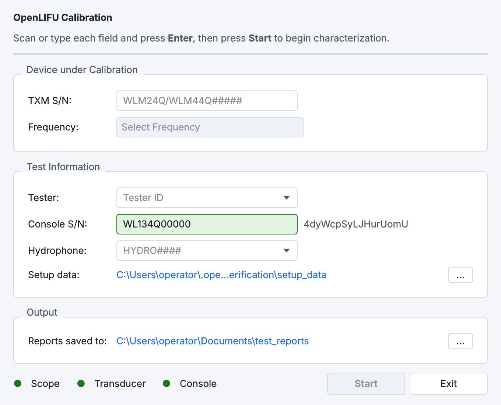

- The **status lights** at the bottom show whether the **Scope**,
  **Transducer** and **Console** are connected (checked every second).
  A red light means that instrument is not detected; **Start** stays
  disabled until all three are green.
- The **Console S/N** fills in by itself when the console is
  connected: it is read from the console, or looked up from its
  hardware ID. The hardware ID is shown to the right.

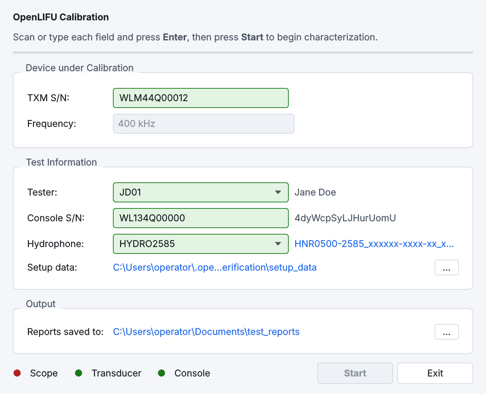

If a light stays red, check that instrument's power and USB cable.
Hover over a light for details.

### 4.2 Enter the identifiers

Fill the fields from top to bottom, normally with the barcode
scanner. Each scan ends with **Enter**, which checks the field and
moves to the next empty one. A field turns **green** when it is
accepted, and **red** with the reason on the right when it is not.

1. **TXM S/N** — scan the S/N on the transmit module
   (`WLM24Q#####` or `WLM44Q#####`). The **Frequency** is set from the
   model code: `WLM24Q` = 155 kHz, `WLM44Q` = 400 kHz.

   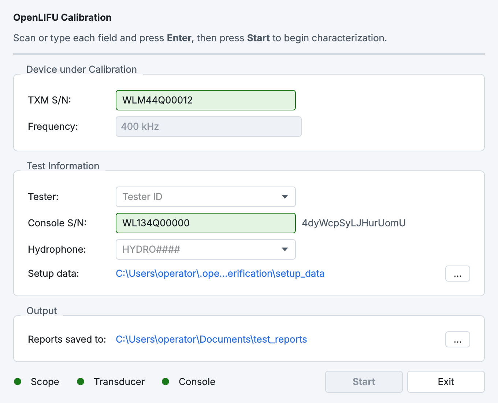

2. **Tester** — scan your tester ID, or click the **▾** arrow and pick
   your name from the list of registered testers.

   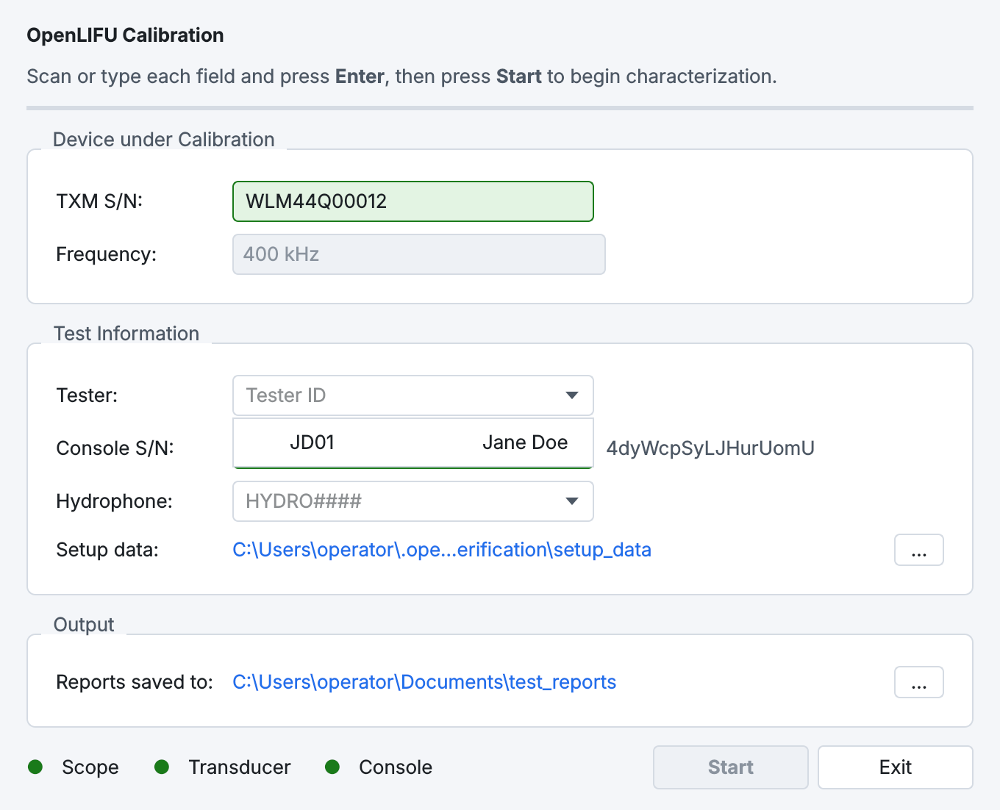

3. **Console S/N** — normally already filled in (4.1). If it is
   empty, scan the S/N on the console label (`WL114Q#####` or
   `WL134Q#####`). An S/N you type or scan is never replaced.

4. **Hydrophone** — scan the barcode on the hydrophone case
   (`HYDRO####`), or pick it from the **▾** list. When it is accepted,
   the name of its calibration file appears on the right.

When every field is green and all lights are green, **Start** turns
blue:

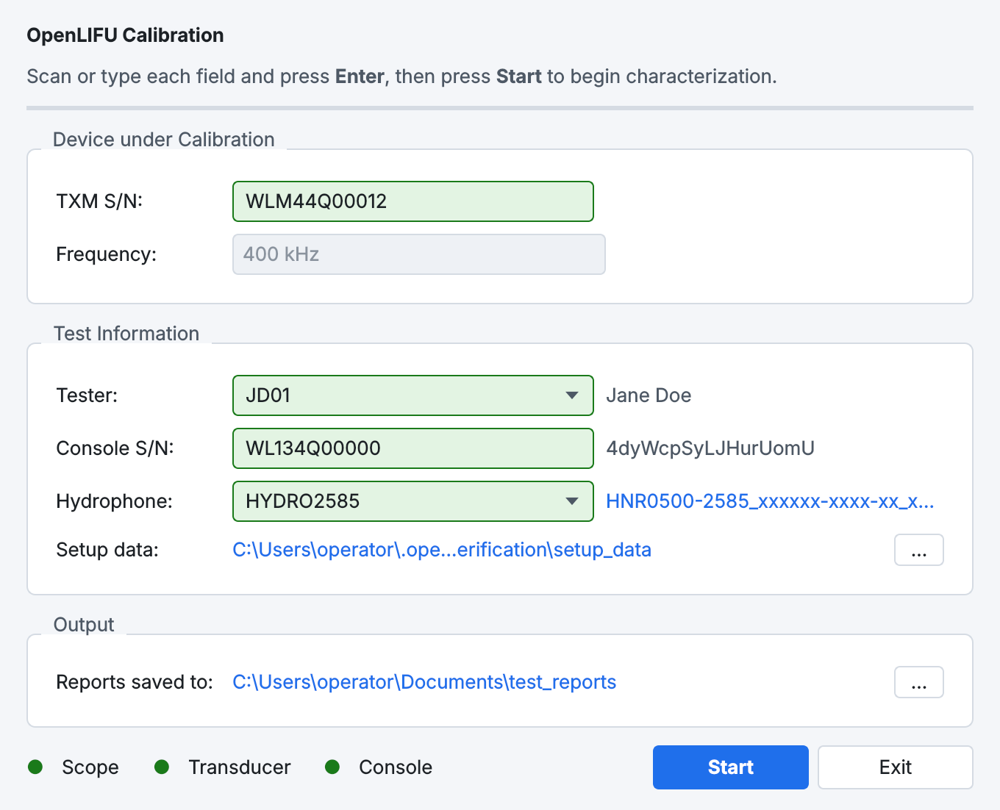

A red field shows what is wrong:

| Message | Meaning / fix |
|---|---|
| `Expected WLM24Q/WLM44Q#####` (or another format) | Mis-scan or typo. Clear the field and scan again. |
| `Not in setup data` | Not registered. Check for a typo; otherwise register it ([section 9](#9-managing-testers-consoles-and-hydrophones)). With add-items mode the message says `(Enter to add)`. |
| `Calibration file missing: …` | The hydrophone is registered but its calibration file is not in `hydrophone_calibrations`. |

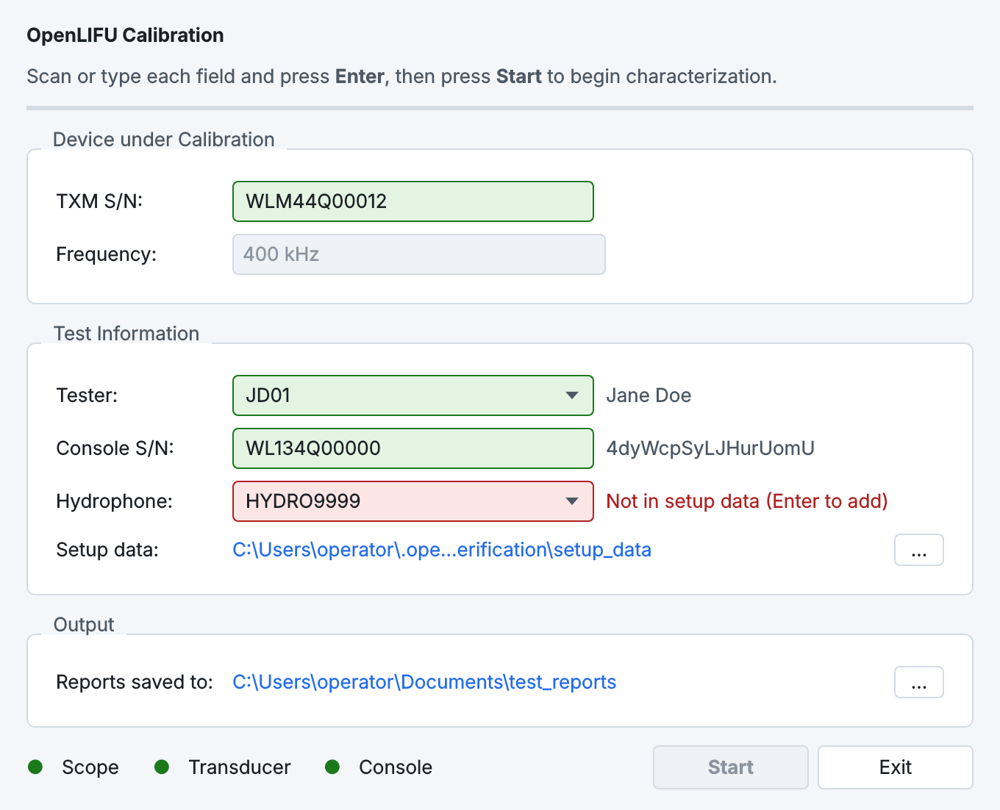

### 4.3 Check the hydrophone calibration (optional)

Click the blue calibration file name next to the hydrophone to see the
calibration it will use: serial number, model, calibration date,
sensitivity at 155 and 400 kHz, and the sensitivity curve from 100 to
500 kHz (dotted lines at 155 and 400 kHz).

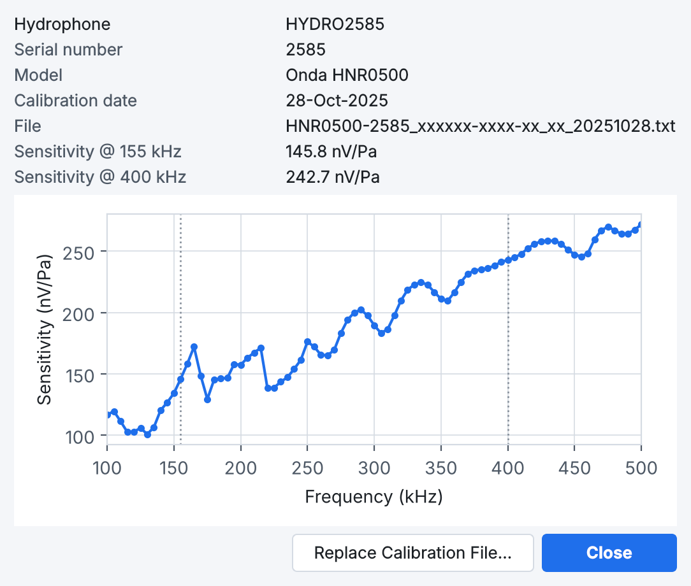

Check that the serial number matches the hydrophone and that the
calibration date is current (calibrations older than 5 years fail the
test). To install a newer calibration file, see
[section 9.3](#93-replace-a-hydrophone-calibration-file).

### 4.4 Start the test

Click **Start**. The progress window shows:

- the current phase, a progress bar, elapsed time and an estimate of
  the time remaining;
- the **acceptance gates**: ○ not started, ◐ in progress,
  ● green = pass, ● amber = pass with a warning, ● red = fail;
- the **log** of what the test is doing.

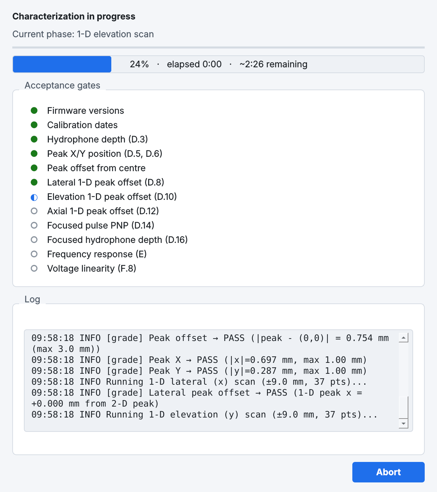

**Do not touch the tank, cables or hydrophone during the test.**
**Abort** stops the test after the step in progress and returns to the
start screen; no report is written.

### 4.5 Results

When the test finishes, the result window shows the overall verdict,
one square per graded check (green = pass, amber = pass with a
warning, red = fail; hover over a square for its value, limit and
note), and links to the report folder, PDF and XLSX. A warning does not
fail the module.

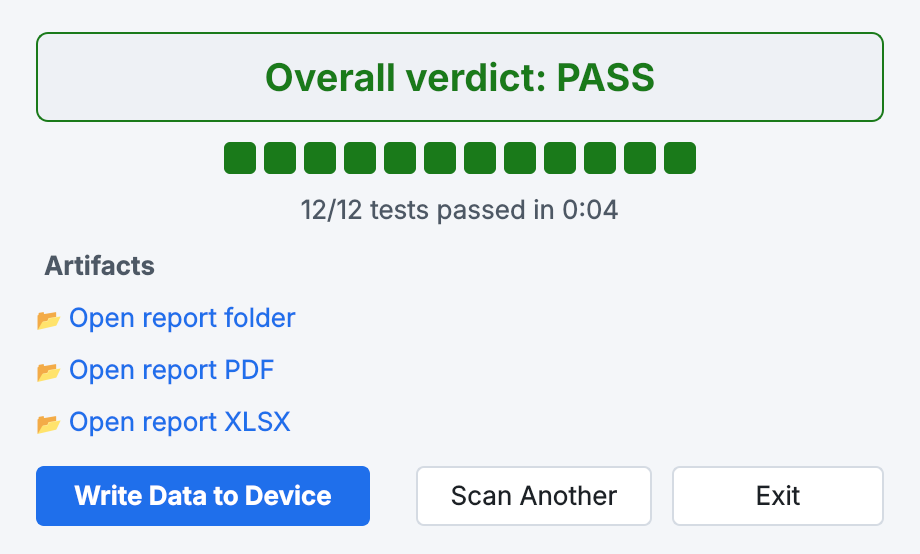

**If the module passed**, click **Write Data to Device** to store its
calibration data on the module. *Calibration data written to device:
OK* confirms it.

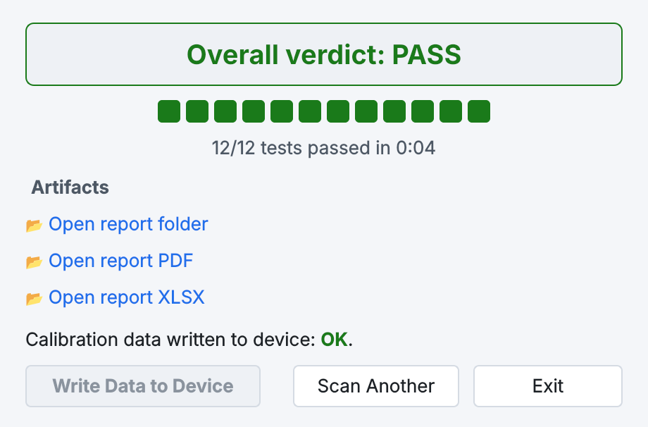

Then choose:

- **Scan Another** — back to the start screen for the next module. The
  tester and hydrophone are kept; scan the next TXM S/N.
- **Exit** — close the application.

If you leave a passing result without writing, the application asks
for confirmation:

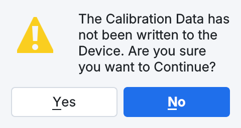

Choose **No** to go back and write the data.

**If the module failed**, the failed checks are red and **Write Data
to Device** is disabled: calibration data can only be written from a
passing, standard test. Review the report (section 8), fix the setup
if needed and test again, or set the module aside.

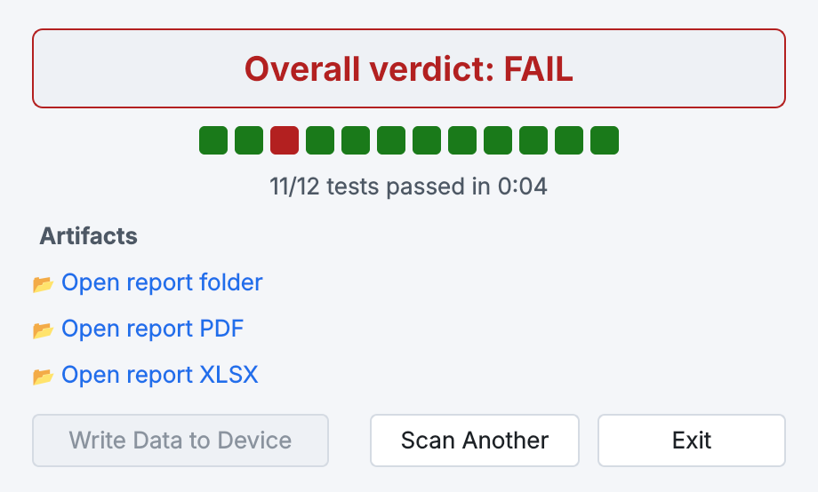

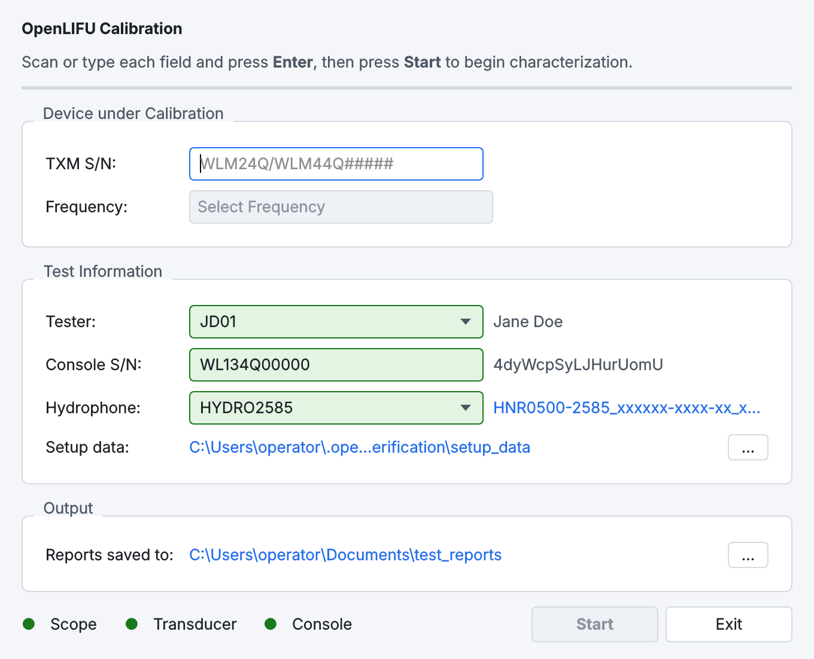

## 5. When a setup step fails: Continue or Abort

The **hydrophone depth calibration** and the **peak search** locate
the hydrophone for every measurement that follows.

**Weak plane wave.** The depth is first measured with a plane wave,
whose signal at the hydrophone is small (especially at 155 kHz). The
software only accepts an arrival near the aligned 50 mm depth that is
clearly above the noise. If it finds none, it measures the depth again
with a pulse focused at 50 mm, whose signal at the hydrophone is much
stronger. If that depth is in range, the test continues and D.3 is
graded **WARN** (amber): the module is not failed for it, and D.3's
note gives the plane-wave signal level. A weak module still fails the
pressure checks (e.g. D.14) if its output is out of specification.

**Depth or peak not found.** If the focused pulse doesn't find the
hydrophone either, if the depth is out of tolerance, or if the peak
search fails, the test pauses and asks what to do:

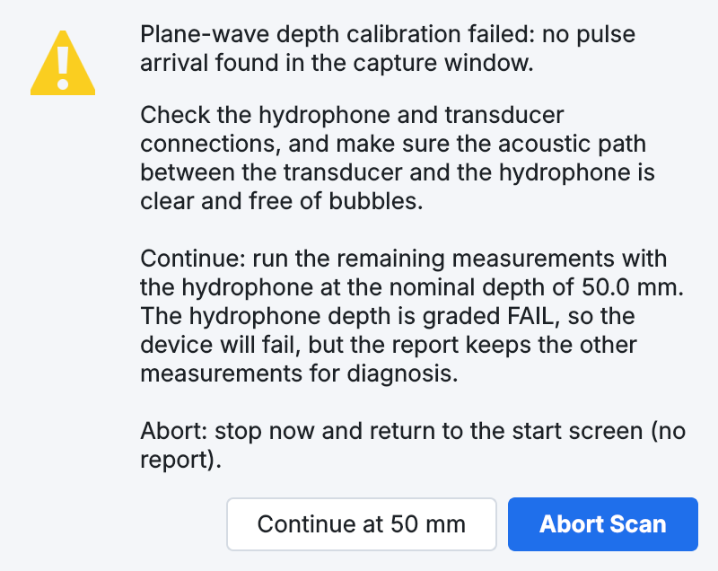

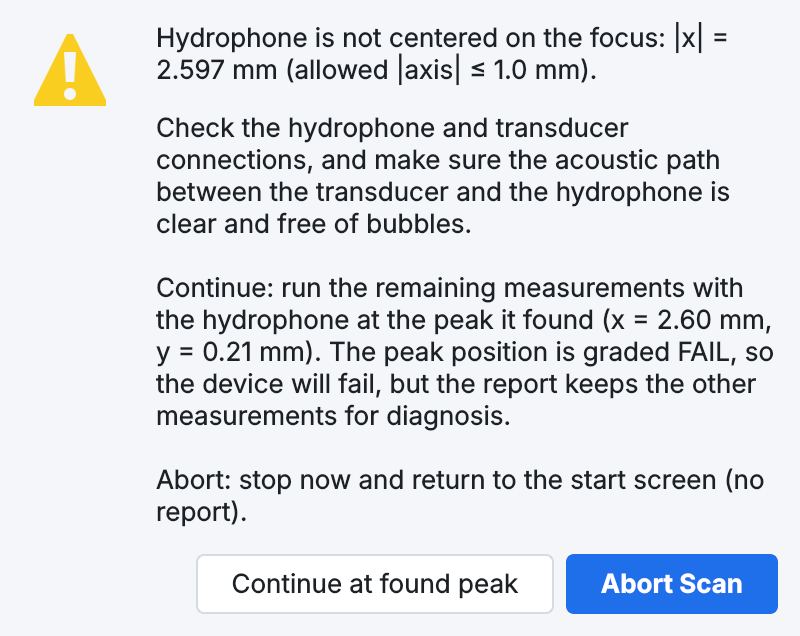

**First check the setup**: hydrophone (channel A) and trigger
(channel B) cables, the transducer seated flush with the connector
engaged, water level touching the transducer face, and no bubbles on
the hydrophone or under the transducer. Then choose:

| Choice | What happens |
|---|---|
| **Abort Scan** (default) | The test stops and the start screen opens again; no report is written. Fix the setup and start again. |
| **Continue at 50 mm** (depth) | The rest of the test runs with the hydrophone at the nominal depth of 50 mm. |
| **Continue at found peak** (peak found off center) | The rest of the test runs around the peak that was found. |
| **Continue at center** (no peak found) | The rest of the test runs at the nominal focus (x = 0, y = 0). |

After **Continue**, the failed step is graded **FAIL**, so the module
fails, but the report keeps all the other measurements. Use this for
modules that keep failing these steps (for example, low-sensitivity
modules) to collect diagnostic data.

## 6. Other messages

| Message | Meaning / what to do |
|---|---|
| **Firmware update required** | The TXM or console firmware is older than required (TXM 2.0.8, console 1.2.7) or could not be read. The test did not run. Update the firmware and start again. |
| **\<instrument\> not connected** | An instrument was not found when the test started. Check power and USB, wait for its light to turn green, and start again. |
| **Scan halted** | A check that the rest of the test depends on failed, e.g. *Connected console hardware ID … does not match …*: the connected console is not the one scanned. Scan the console that is actually connected. |
| **Scan aborted** | Abort was pressed. No report was written. |
| **Run failed** | Unexpected software error. The message contains the details; send it, with the log, to the software maintainers. |
| **NON-STANDARD** (red banner) | The test was started with a diagnostic option (`--scan-config`, `--voltage`, `--skip-*`). Its report is marked NON-STANDARD and calibration data cannot be written. |

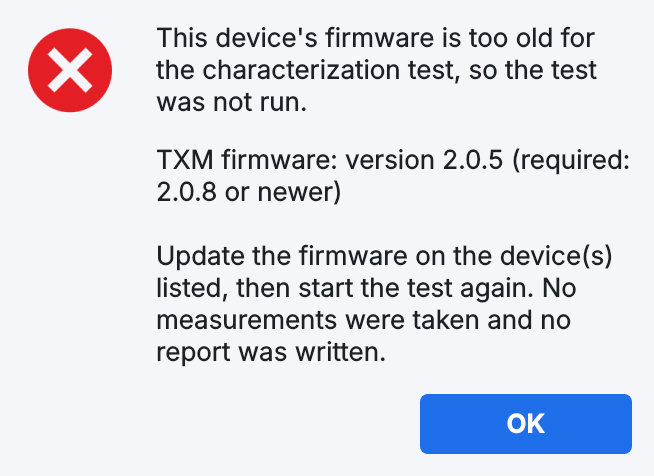

## 7. What is measured and graded

Each gate in the progress window corresponds to report rows. The
module passes only if every graded check passes.

| Gate / report row | Passes when |
|---|---|
| Firmware versions (B.4, C.3) | TXM ≥ 2.0.8 and console ≥ 1.2.7 |
| Calibration dates (A.7, A.11) | Hydrophone and PicoScope calibrations ≤ 5 years old |
| Hydrophone depth (D.3) | Plane-wave depth within 50.0 ± 2.0 mm. If the plane wave is too weak, the focused-pulse depth is used and an in-range result is **WARN** (does not fail) |
| Peak X/Y position (D.5, D.6) | Peak within ±1.0 mm of center on each axis (offset from center ≤ 3 mm) |
| Lateral / elevation 1-D peak offset (D.8, D.10) | 1-D peak within 1.0 mm (155 kHz) or 0.5 mm (400 kHz) of the 2-D peak |
| Axial 1-D peak offset (D.12) | Axial peak between −5 and +10 mm of the hydrophone depth |
| Focused pulse PNP (D.14) | PNP at the peak ≥ 0.41 MPa (155 kHz) or 0.66 MPa (400 kHz) at 50 V (scaled to the drive voltage) |
| Focused hydrophone depth (D.16) | Focused-pulse depth within 50 mm ± 5 % (fails if the focused arrival can't be found) |
| Frequency response (E.13) | PNP at the nominal frequency within 40 % (155 kHz) or 15 % (400 kHz) of the sweep's peak |
| Voltage linearity (F.8) | Linear fit of PNP vs. voltage with R² ≥ 0.99 |

The default drive voltage is 40 V at 155 kHz and 20 V at 400 kHz.

## 8. Report files

Each test is written to a new folder:
`<reports folder>\<TXM S/N>\<YYYYMMDD_HHMMSS>\`. The reports folder is
shown on the start screen and defaults to `test_reports` in the
application's working folder (change it with **…** in add-items mode,
or `--reports-root`).

| File | Contents |
|---|---|
| `<stem>_Report.pdf` | Report: all rows with verdicts, then the figures |
| `<stem>_Report.xlsx` | Same report as a spreadsheet |
| `<stem>_summary.csv` | One row per report row |
| `<stem>_device_config.json` | Calibration data written by *Write Data to Device* |
| `<stem>_scan_config.json` | Scan settings used |
| `<stem>_console.log` | Full log of the test |
| `*.csv`, `figures\*.png`, `raw\*.npz` | Scan data, figures and raw captures |
| `operator_prefs_snapshot.json` | Tester / serial numbers entered |

`<stem>` is `<TXM S/N>_<YYYYMMDD_HHMMSS>`. The first page of the PDF
looks like this (dry-run data):

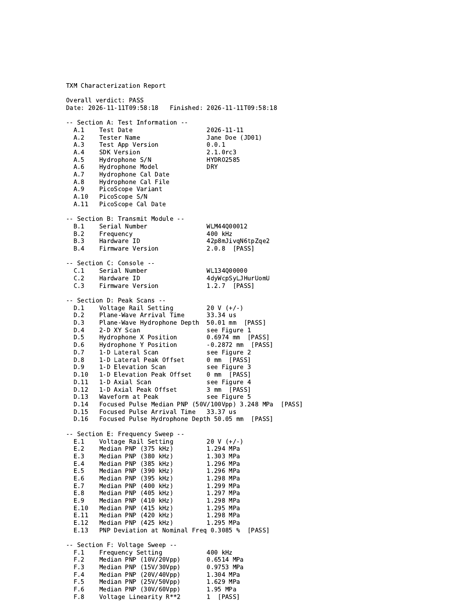

## 9. Managing testers, consoles and hydrophones

Registering items requires **add-items mode**
([section 3](#3-station-setup-the-setup-data-folder)).

### 9.1 Add a tester, console or hydrophone

Scan the new ID into its field and press **Enter**. If it is
well-formed but not registered, the application asks for its details:

- **Tester** — the tester's name.

  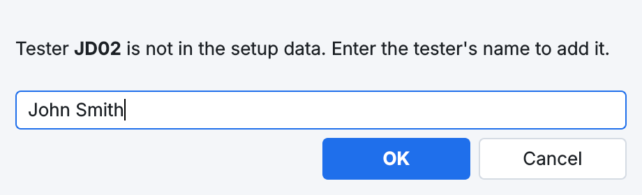

- **Console** — its hardware ID. With the console connected, click
  **Read from console**; when the S/N was detected from the console,
  the hardware ID is already filled in.
- **Hydrophone** — its calibration file (**Browse…**). The file is
  copied into `hydrophone_calibrations`.

Click **OK**; the item is saved to the setup data and the field turns
green.

### 9.2 Pick from the registered items

The **▾** arrow in the Tester and Hydrophone fields lists the
registered items (tester name or calibration file shown alongside).
Picking one is the same as scanning it.

### 9.3 Replace a hydrophone calibration file

When a hydrophone is recalibrated:

1. Start the application in add-items mode and enter the hydrophone.
2. Click its calibration file name to open the calibration preview.
3. Click **Replace Calibration File…** and select the new file. The
   preview shows the current and new calibrations side by side
   (values and both curves).
4. Check the comparison. The application warns if the new file's
   serial number does not match the hydrophone, if its calibration
   date is not newer, or if it has the same file name.
5. Click **Save**. The hydrophone now uses the new file; the old file
   is kept, because earlier reports refer to it.

### 9.4 Change folders

In add-items mode, **…** next to *Setup data* or *Reports saved to*
changes that folder. A setup data folder chosen here becomes the
active one for the application and the scripts. If it is missing
files, the application offers to copy in the template.

## 10. Command-line options

The release build and `python scripts\run_report_gui.py` accept these
options (run with `--help` for the full list):

| Option | Effect |
|---|---|
| `--add-items` / `--no-add-items` | Turn add-items mode on / off for this run (default: `gui_settings.json`) |
| `--use-last-setup` | Pre-fill tester, console and hydrophone from the last test |
| `--setup-data FOLDER` | Use this setup data folder |
| `--reports-root FOLDER` | Write reports under this folder |
| `--theme Dark` | Dark color theme |
| `--dry-run` | Practice mode with simulated hardware ([section 11](#11-practice-mode-dry-run)) |
| `--ext-power` | Use the external QPX600DP HV supply instead of the console |
| `--no-validate` | Accept any TXM S/N, tester and console and pick the frequency by hand (diagnostics) |
| `--voltage V`, `--skip-2d`, `--skip-frequency`, `--skip-voltage`, `--scan-config FILE` | Diagnostics; the report is marked NON-STANDARD and calibration data cannot be written |

`scripts\run_report.py` runs the same test from the command line,
without the windows: it asks for the operator details in the terminal,
and asks *Continue at …? [y/N]* when a setup step fails (with
`--no-prompt` it stops instead).

## 11. Practice mode: dry run

`--dry-run` runs the whole application with **simulated** instruments
and synthetic measurements, for training and testing; no real device
is touched, even if one is connected. The status lights are labelled
*Simulated*; click a light to unplug or plug in that simulated
instrument. The simulated console's S/N is `WL134Q00000`; register it
(add-items mode, **Read from console** for its hardware ID) to have it
accepted. Dry-run reports contain synthetic data and must not be used
for real modules.

## 12. Troubleshooting

### 12.1 `PicoSDK (ps5000a) not found, check PATH`

The PicoSDK `lib` folder is not on `PATH` (see 2.1). Check with
`dir "C:\Program Files\Pico Technology\SDK\lib\ps5000a.dll"`. If the
DLL is only under `C:\Program Files (x86)`, the 32-bit SDK is
installed; install the 64-bit one. Terminals started before the
change keep the old `PATH`: open a new one, and quit **all** VS Code
windows before reopening VS Code.

### 12.2 PowerShell: "running scripts is disabled on this system"

When activating the Python environment, run once:
`Set-ExecutionPolicy -Scope CurrentUser RemoteSigned`. Alternatively
use Command Prompt (`.venv\Scripts\activate`) or call
`.venv\Scripts\python.exe` directly.

### 12.3 A status light stays red

Check the instrument's power and USB cable, and that no other program
(e.g. the PicoScope application) is using it. The lights only detect
that the device is plugged in; the test checks the connection again
when it starts.

### 12.4 The Console S/N is not filled in

The field shows why:
*Console S/N not set; scan or type it* — the console has no S/N
stored and its hardware ID is not registered: scan the S/N from the
console label. *Could not read console* — hover over it for the error;
check the console's USB connection. Detection runs when the console
light turns green and never replaces an S/N you entered.

### 12.5 A barcode scans wrongly

Click into the field, clear it, and scan again (or type the ID). The
field must turn green before Start is enabled.

### 12.6 The hydrophone depth or peak search keeps failing

See [section 5](#5-when-a-setup-step-fails-continue-or-abort). Check
cables, transducer seating, water level and bubbles. If the setup is
correct, use **Continue** to collect diagnostic data and flag the
module.
